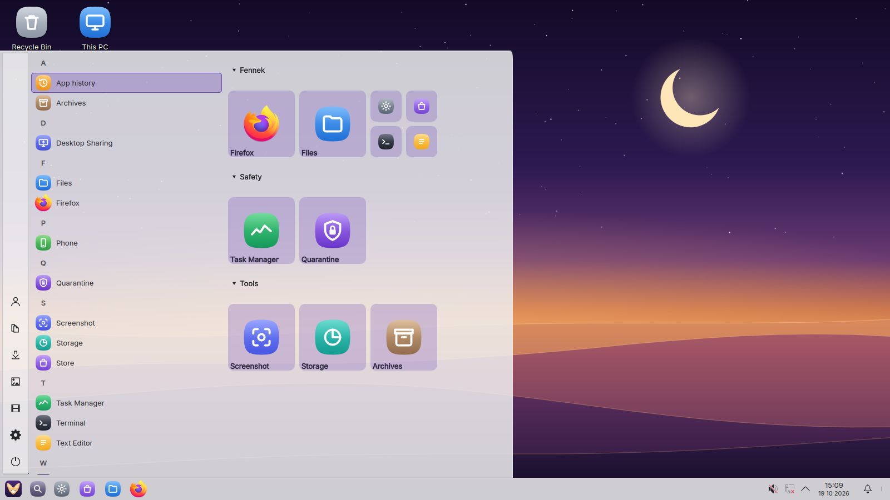

# Fennek OS

A Linux desktop for **people who want a familiar, classic desktop**. It feels familiar, has no telemetry, comes with strong
built-in security, and aims for long battery life.
Built as a [bootc](https://containers.github.io/bootc/) image on Fedora Kinoite (KDE Plasma).



What's in it so far:

- **`.exe` programs:** double-click any `.exe`, which runs it through Proton (umu-launcher).
- **Auto-containment:** unknown programs run in a sandbox. They see only `~/Sandbox/<program>` and never your real home.
- **VirusTotal check:** right-click any file. Only the file's hash is sent, never the file.
- **Download guard:** ClamAV scans new files in Downloads, and threats go to quarantine. No always-on scanner daemon.
- **Hourly home snapshots:** Btrfs and snapper, as an undo for ransomware.
- **Atomic updates:** updates are staged in the background and applied on the next reboot. They are never forced.
- **Familiar:** classic taskbar, and `dir`, `cls`, `ipconfig` work in the terminal.


## Install

> **Early test version.** Try it on a spare PC or "Try it first" from the USB stick before installing for real.

**What you need:** a USB stick (8 GB or more, it will be erased), about 30 minutes, and a backup of your files.

1. **Back up your files** to an external drive or a cloud folder. Installing next to your current system keeps
   it, but a backup is what makes any mistake harmless.
2. **Your current system's drive encryption:** if it uses one, write down its recovery key now.
3. **Download the installer** (`.iso`): open [the latest installer build](https://github.com/Olexify/FennekOS/actions/workflows/iso.yml),
   pick the newest green run and download `fennek-os-iso` at the bottom (needs a free GitHub account; a direct
   download link is coming with the website).
4. **Put it on the USB stick** with [Fedora Media Writer](https://flathub.org/apps/org.fedoraproject.MediaWriter)
   or [balenaEtcher](https://etcher.balena.io/): choose the `.iso`, choose the stick, Write.
5. **Start from the stick:** restart the PC and press the boot menu key while it starts (often **F12**, **F11**,
   **F8** or **Esc**; the start screen usually says which), then pick the USB stick.
6. **Look around first:** choose **Try it first**. Nothing on your PC changes until you choose to install.
7. **Install:** click **Install Fennek OS** on the desktop.
   - **Keep your current system** (recommended): at *Installation Destination*, pick your drive, then
     **Free up space** and **Shrink** your current system's partition (leave it at least 30 GB free). Fennek OS goes
     into the freed space. When the PC starts you choose which system to use.
   - **Replace it:** pick your drive and **Delete all**. Everything on that drive is gone.
8. Restart, take out the stick, and you are in Fennek OS. Updates arrive by themselves; the previous version
   always stays in the start menu in case one goes wrong.

## Build

Base: Universal Blue's Kinoite, signature-verified and pinned by digest. Build with podman (the base has
~256 layers, more than docker supports):

```bash
base=$(bash verify-base.sh)
podman build --build-arg BASE_IMAGE=$base -f Containerfile -t fennek:dev .
podman run --rm -v ./test.sh:/t.sh:ro fennek:dev bash /t.sh
```

Test VM (Hyper-V):

1. `vm-disk.ps1` builds and tests the image, then writes `E:\Fennek-build\vm\fennek-next.vhdx`.
2. `vm.ps1`, run as admin, creates the VM and boots it.

## Contributing, security, license

- Want to help? See [CONTRIBUTING.md](CONTRIBUTING.md).
- Found a security problem? Report it privately; see [SECURITY.md](SECURITY.md).
- What Fennek OS connects to, and how to turn it off: [PRIVACY.md](PRIVACY.md).
- Fennek OS's own code is licensed under [GPL-3.0](LICENSE). Bundled components keep their own licenses.
- The name "Fennek OS" and the fox logo are not covered by the GPL; forks must rename. See [TRADEMARKS.md](TRADEMARKS.md).
